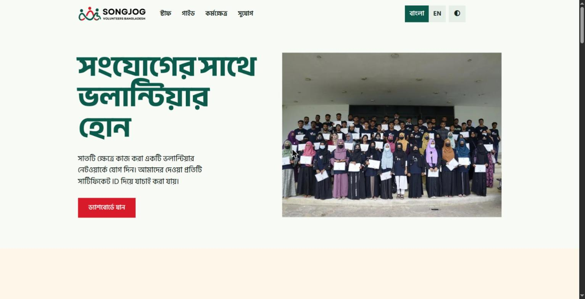
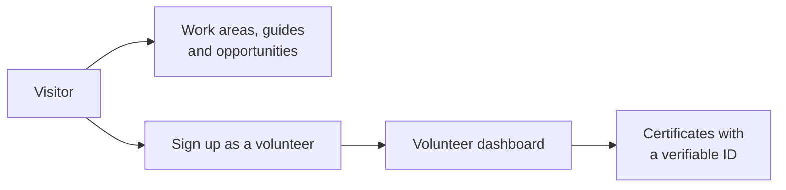

# SVB Volunteer Portal

[svb.songjog.org](https://svb.songjog.org) is the website and portal of Songjog Volunteers Bangladesh (SVB), the volunteer network of Songjog Foundation. Students, professionals and young people join from Bangladesh and abroad, on site or remotely, to work on education, training, healthcare, awareness and climate projects.

## What it does

- Bangla and English, with a light and dark theme
- Pages for staff, guides, work areas and opportunities
- A dashboard for each volunteer
- Every certificate the network gives can be checked by its ID

## My role

I wrote the spec, designed the site and built it in Django. Changes go in small reviewed batches, tests first, one commit per batch.

## Built with

Django · Python

## Status

Deployed at [svb.songjog.org](https://svb.songjog.org) and in final testing. The code is private.
